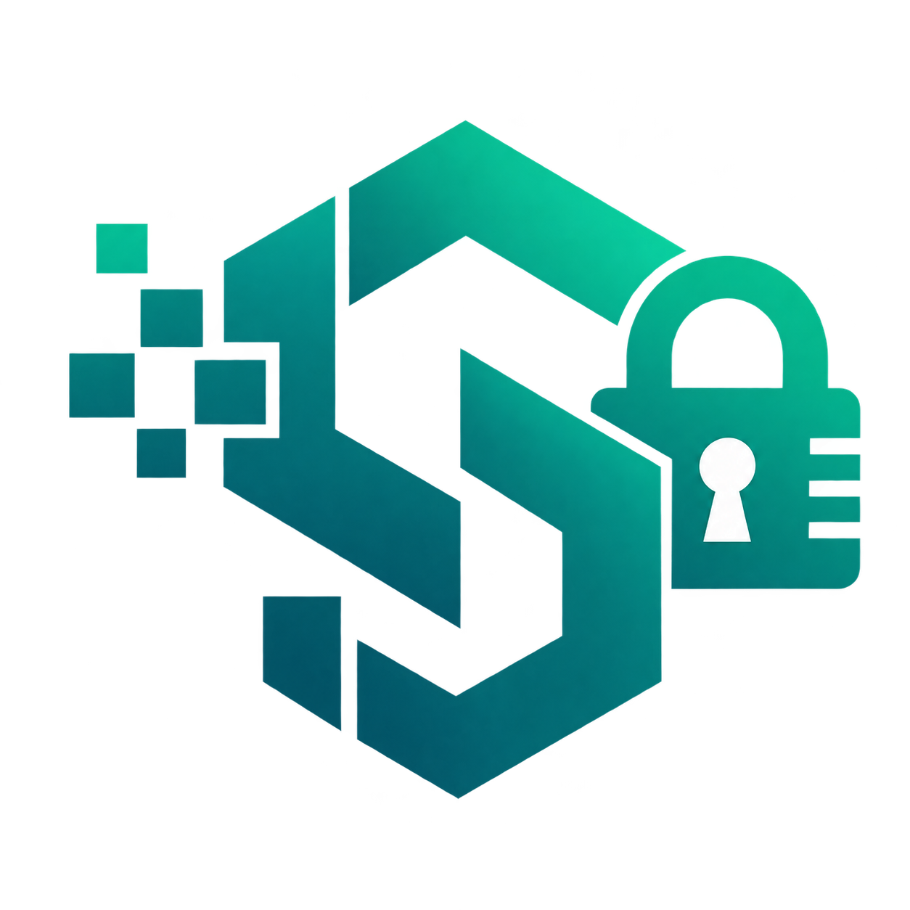

<p align="center">
  
</p>

<h1 align="center">StegoVault</h1>

<p align="center">
  Offline PNG steganography with AES-GCM-encrypted, integrity-checked payloads.
</p>

## Overview

StegoVault is a JavaFX desktop application for hiding and recovering data inside PNG images using Least Significant Bit (LSB) steganography. It is designed for local, offline use: files are processed on the user's machine, and no account, cloud service, or database is involved.

The application combines:

- LSB payload embedding and extraction
- Optional password-based AES-GCM encryption using PBKDF2-HMAC-SHA256 key derivation
- SHA-256 payload integrity verification
- Image inspection and payload detection
- A JavaFX desktop interface

## Features

### Hide Data

- Hide a typed text message or import a file as the payload. Imported files must have a MIME type that the Java runtime can detect; see Known Limitations for the edge case.
- Choose a PNG cover image and preview it.
- View image dimensions, file size, and an estimated embedding capacity before hiding.
- Optionally protect the payload with a password.
- Password strength feedback and password confirmation are shown. The feedback is advisory; weak passwords are not blocked.
- Strip image metadata by re-encoding the cover image to RGB before embedding.
- Save the resulting stego image as a PNG.

### Extract Data

- Select a StegoVault PNG and recover the hidden payload.
- Enter the password used during hiding. For payloads hidden without a password, leave the field blank; this works only in the same application session.
- Save the recovered file to a chosen location.
- Display the recovered file name, MIME type, size, and save path.

### Analyze

- Inspect PNG properties: dimensions, reported format, alpha presence, file size, pixel count, and estimated embedding capacity.
- Detect whether an image contains a StegoVault payload without decrypting it.
- A detected payload has already passed the stored SHA-256 checksum check.
- The reported format is derived from the filename extension, not from inspecting the image encoding.

### About

- View application identity and version information, security configuration, and steganography configuration.
- The screen is read-only; no editable settings screen is implemented.

## Security and Privacy

- AES-GCM encryption with a 128-bit authentication tag.
- PBKDF2-HMAC-SHA256 key derivation with 120,000 iterations and a 256-bit key.
- A random 16-byte salt is generated for each password-protected payload.
- A random 12-byte IV is generated for each encryption operation.
- A 42-byte payload header stores magic bytes, format version, flags, payload length, and a SHA-256 checksum. The checksum verifies payload integrity; AES-GCM's authentication tag, not the checksum, provides cryptographic authentication.
- Password-protected payloads can be extracted after restarting the application.
- Payloads hidden without a password use a random session key generated at application startup. That key exists only in memory and is never written to disk, so blank-password payloads can be extracted only while the same application session is running. Use a password for payloads that must remain extractable after restarting the application.
- Image metadata is stripped before embedding by re-encoding the cover image to RGB.
- The application operates offline by default. It does not require an account, cloud service, or database.

## Technologies Used

| Technology | Purpose |
|---|---|
| Java 21 | Application development |
| JavaFX 21.0.2 | Desktop user interface |
| Maven with Maven Wrapper | Build and dependency management |
| Java Image I/O (AWT) | PNG reading and writing |
| AES-GCM | Payload encryption |
| PBKDF2-HMAC-SHA256 | Password-based key derivation |
| SHA-256 | Payload integrity verification |
| LSB steganography | Data embedding and extraction |
| CSS | JavaFX UI styling |

## Requirements

### Build and Run from Source

- JDK 21
- Maven 3.9+ or the included Maven Wrapper (`./mvnw`)
- Network access on the first build to download Maven dependencies
- A desktop environment capable of running JavaFX applications

### Install the Debian Package

- Debian-based Linux distribution
- `amd64` architecture
- A desktop environment capable of running JavaFX applications
- The generated package: `target/dist/stegovault_1.0_amd64.deb`

The existing package was verified on Linux Mint 22.3 (`amd64`). Other distributions and architectures were not verified.

## Build and Run Instructions

Clone the repository and run the application with the JavaFX Maven plugin:

```bash
git clone https://github.com/Vazim-Bijumon/StegoVault.git
cd StegoVault
./mvnw clean package
./mvnw javafx:run
```

`./mvnw clean package` compiles the application and produces `target/StegoVault-1.0-SNAPSHOT.jar`.

The JAR is a regular application JAR, not a self-contained executable fat JAR. It has no `Main-Class` manifest entry and does not bundle JavaFX, so launch the application with the configured JavaFX Maven plugin:

```bash
./mvnw javafx:run
```

JUnit is declared in `pom.xml`, but there are currently no automated test sources in the repository.

## Linux Installation Using the Generated .deb Package

The generated Debian package is:

```text
target/dist/stegovault_1.0_amd64.deb
```

This file is not committed to Git because the `target/` directory is ignored. If the package is not present, obtain or generate it before continuing. No packaging script is committed to the repository.

Install it with `apt`:

```bash
sudo apt install ./target/dist/stegovault_1.0_amd64.deb
```

If `apt` is not available for a local package, use `dpkg` followed by dependency repair:

```bash
sudo dpkg -i target/dist/stegovault_1.0_amd64.deb
sudo apt-get install -f
```

Launch the installed application:

```bash
/opt/stegovault/bin/StegoVault
```

Uninstall it with:

```bash
sudo apt remove stegovault
```

Installation notes:

- The package installs under `/opt/stegovault`.
- The package does not create a `/usr/bin` launcher or a desktop-menu entry. Launch it from `/opt/stegovault/bin/StegoVault`.
- The Debian package is `amd64` and version `1.0`.
- The package installation was verified on Linux Mint 22.3 (Ubuntu 24.04 base), `amd64`.
- The About screen reports the application version as `1.0-SNAPSHOT`, while the Debian package is version `1.0`.

## Project Structure

```text
src/main/java/stegovault/
├── Analysis/
│   ├── ImageAnalyser.java
│   ├── ImageValidator.java
│   └── MetaDataCleaner.java
├── core/
│   ├── AppInfo.java
│   ├── CryptoManager.java
│   ├── FileManager.java
│   ├── KeyManager.java
│   ├── KeyMaterial.java
│   ├── Payload.java
│   ├── PayloadHeader.java
│   ├── PayloadMetadata.java
│   ├── PayloadSerializer.java
│   ├── SessionManager.java
│   └── StegoVaultService.java
├── exception/
│   ├── InvalidPayloadException.java
│   └── StegoVaultException.java
├── models/
│   ├── CapacityInfo.java
│   ├── ImageInfo.java
│   └── PayloadDetectionResult.java
├── steganography/
│   ├── BitStreamReader.java
│   ├── BitStreamWriter.java
│   ├── CapacityCalculator.java
│   ├── LSBdecoder.java
│   ├── LSBEncoder.java
│   ├── PayloadDecoder.java
│   └── PayloadEncoder.java
├── ui/
│   ├── MainWindow.java
│   ├── Sidebar.java
│   └── SplashScreen.java
├── views/
│   ├── AnalyzeView.java
│   ├── ExtractView.java
│   ├── HideDataView.java
│   └── SettingsView.java
└── Main.java

src/main/resources/
├── images/
│   ├── icon.png
│   ├── logo.jpg
│   └── logo.png
└── styles/
    └── stegovault.css
```

No automated test sources are currently committed, so there is no `src/test/` directory.

## Known Limitations

- The UI workflow supports PNG images only. The analysis validator recognizes BMP, but all file choosers are restricted to PNG, so BMP cannot be selected through the interface.
- Payloads hidden without a password use a per-launch session key. They can be extracted only while the same application session is running; use a password for payloads that must remain extractable after restarting.
- The displayed embedding capacity is an upper bound. It subtracts the 42-byte payload header but not serialized filename/MIME metadata or encryption overhead (IV, authentication tag, and salt).
- Importing a payload file whose MIME type cannot be detected, such as a file with an unknown extension or no extension, can fail without a controlled error message in the UI.
- The extraction password prompt is not masked and appears for every selected image, including payloads that were hidden without a password.
- Analyze infers the image format from the filename extension. A payload that is present but corrupted is reported as "No StegoVault payload detected" rather than as a separate integrity failure.
- There is no editable settings screen; the About screen is read-only.
- There are no automated tests. No packaging script is committed; the `.deb` is generated locally under the ignored `target/` directory.
- No UI screenshots are currently included in the repository. The tracked image assets are the application logo and icon.
